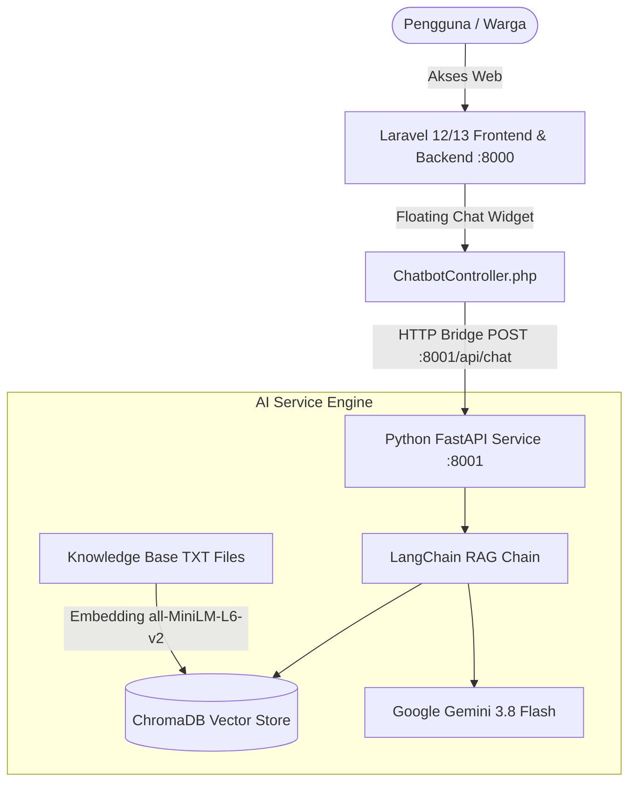

# Dokumentasi Proyek PojokNgadiluwih
> **Sistem Informasi Desa Modern & Asisten AI Interaktif Berbasis Retrieval-Augmented Generation (RAG)**

---

## 📌 1. Ringkasan Proyek

**PojokNgadiluwih** adalah platform digital terintegrasi untuk Desa Ngadiluwih yang menggabungkan website layanan publik, katalog promosi UMKM warga, pusat informasi administrasi desa, dan asisten virtual pintar (*AI Chatbot*) berbasis kecerdasan buatan Google Gemini.

Website ini dirancang untuk memudahkan warga mengakses informasi surat-menyurat, jam operasional, profil desa, hingga produk lokal warga secara mandiri, cepat, dan ramah pengguna selama 24 jam.

---

## 🏗️ 2. Arsitektur & Teknologi

Proyek ini menggunakan arsitektur **Hybrid Monolith + Microservice AI**:



### Stack Teknologi:
- **Aplikasi Web Utama**:
  - Framework: **Laravel 12 / PHP 8.4**
  - Templating: **Blade Component & Tailwind CSS**
  - Database: **SQLite / MySQL Support**
- **Layanan Asisten AI (RAG Service)**:
  - Framework: **FastAPI (Python 3.12/3.13)**
  - Orkestrasi LLM: **LangChain & LangChain Google GenAI**
  - Model Bahasa (LLM): **Google Gemini (`gemini-3.8-flash`)**
  - Vector Store: **ChromaDB**
  - Text Embedding: **Sentence-Transformers (`all-MiniLM-L6-v2`)**

---

## 🚀 3. Apa Saja yang Telah Dikerjakan?

### A. Struktur Folder & Controller Komprehensif
1. **Public Controllers (`app/Http/Controllers/Public/`)**:
   - `HomeController.php`: Landing page interaktif dan ringkasan layanan.
   - `ProfileController.php`: Profil wilayah, sejarah, visi misi, dan struktur perangkat desa.
   - `NewsController.php`: Berita desa, agenda, dan pengumuman warga.
   - `UmkmController.php`: Katalog produk UMKM desa dengan tombol *Direct-to-WhatsApp* pemesanan langsung ke penjual.
   - `ServiceController.php`: Panduan pengajuan surat (SKU, SKCK, SKTM, Domisili), form pengajuan toko UMKM, dan form aspirasi warga.
   - `DemographicsController.php`: Data statistik demografi, kelompok usia, mata pencaharian, dan bantuan sosial.
   - `ChatbotController.php`: Controller jembatan (*bridge*) yang menghubungkan UI chat dengan service Python AI, dilengkapi mekanisme *fallback* cerdas jika service AI sedang offline.

2. **Admin Controllers (`app/Http/Controllers/Admin/`)**:
   - `DashboardController.php`: Ringkasan statistik kunjungan, permohonan surat, dan status UMKM.
   - `ContentController.php`: CMS publikasi berita dan agenda desa.
   - `UmkmApprovalController.php`: Verifikasi dan persetujuan pengajuan toko UMKM warga.
   - `DocumentServiceController.php`: Arsip dan verifikasi berkas permohonan surat warga.
   - `InsightsController.php`: Laporan aspirasi warga dan rekomendasi kebijakan desa berbasis data.
   - `AiKnowledgeController.php`: Manajemen basis pengetahuan AI (sinkronisasi dokumen `.txt` dan pemicu indeks ulang vektor).

### B. Antarmuka Pengguna & Komponen Chatbot
- **Floating Chatbot Widget (`resources/views/layouts/components/chatbot-widget.blade.php`)**:
  - Tombol melayang (*floating button*) dengan indikator status online beranimasi.
  - Jendela obrolan responsif dengan scroll otomatis dan avatar asisten desa.
  - **Quick Action Prompts**: Tombol pintasan pertanyaan instan (*"Bisa Nanya Apa?"*, *"Panduan Surat"*, *"UMKM Kuliner"*, *"Jam Layanan"*).
  - **Smart Markdown Rendering**: Pemformatan otomatis untuk teks tebal (`**teks**`), miring (`*teks*`), dan baris baru (`\n` $\rightarrow$ `<br>`) agar jawaban AI rapi dan mudah dicerna.

### C. Mesin AI Conversational Assistant (FastAPI + LangChain RAG)
- **Modul Konfigurasi & Lingkungan (`ai_service/app/config.py`)**:
  - Konfigurasi otomatis Google API Key dan path data vektor.
- **Modul Basis Data Vektor (`ai_service/app/vector_store.py`)**:
  - Ingestion dokumen teks pengetahuan desa dengan `DirectoryLoader` dan pemecah teks `RecursiveCharacterTextSplitter`.
  - **Singleton Caching**: Penyimpanan instance model embedding dan ChromaDB di memori untuk mencegah reload berulang, menurunkan waktu respons dari 15+ detik menjadi **1–2 detik**.
- **Modul RAG & Prompt Engineering (`ai_service/app/rag_chain.py`)**:
  - Integrasi model `gemini-3.8-flash`.
  - Prompt sistem ramah bernuansa desa yang mampu:
    1. Menjawab pertanyaan seputar desa secara akurat sesuai dokumen.
    2. Menjelaskan kapabilitas asisten saat ditanya *"bisa nanya apa saja disini"*.
    3. Merespon dengan sopan dan **mengarahkan pengguna kembali ke topik desa** jika ada pertanyaan di luar topik (mencegah halusinasi).
- **Knowledge Base Resmi Desa (`ai_service/data/knowledge_base/`)**:
  - `profil_desa.txt`: Struktur perangkat desa, 4 wilayah dusun (Krajan, Wonorejo, Sukorejo, Karangrejo), visi misi, dan fasilitas.
  - `layanan_surat.txt`: Jam pelayanan balai desa (Senin-Jumat 08.00-15.00), syarat SKU, SKCK, SKTM, dan alur permohonan.
  - `katalog_umkm.txt`: Daftar UMKM unggulan warga desa beserta nomor WhatsApp pemesanan langsung.
  - `panduan_asisten_ai.txt`: Pedoman kapabilitas asisten virtual dan contoh pertanyaan umum warga.

---

## 🛠️ 4. Panduan Menjalankan Proyek (Untuk Anda & Rekan Kolaborator)

### Prasyarat
- PHP 8.2 atau 8.4 & Composer
- Node.js & NPM
- Python 3.10+ (disarankan Python 3.11 atau 3.12)
- Git

### Langkah 1: Menjalankan Aplikasi Web Laravel
1. Masuk ke direktori root proyek:
   ```bash
   cd d:/pojokngadiluwih
   ```
2. Salin environment file (jika clone baru):
   ```bash
   copy .env.example .env
   composer install
   php artisan key:generate
   ```
3. Pastikan konfigurasi URL AI di `.env` sudah ada:
   ```env
   AI_SERVICE_URL="http://127.0.0.1:8001/api/chat"
   ```
4. Jalankan migrasi database:
   ```bash
   php artisan migrate
   ```
5. Install asset frontend & build:
   ```bash
   npm install
   npm run build
   ```
6. Jalankan server Laravel:
   ```bash
   php artisan serve
   ```
   *(Aplikasi web dapat diakses di `http://127.0.0.1:8000`)*

### Langkah 2: Menjalankan AI Service Python
1. Masuk ke folder service AI:
   ```bash
   cd ai_service
   ```
2. Buat virtual environment & aktifkan:
   - **Windows**:
     ```bash
     python -m venv .venv
     .venv\Scripts\activate
     ```
3. Install dependencies:
   ```bash
   pip install -r requirements.txt
   ```
4. Buat file `.env` di dalam folder `ai_service/`:
   ```bash
   copy .env.example .env
   ```
   Isi file `ai_service/.env` dengan API Key Gemini Anda:
   ```env
   GOOGLE_API_KEY="AIzaSy... (API Key Anda)"
   ```
5. Jalankan server FastAPI:
   ```bash
   uvicorn app.main:app --host 127.0.0.1 --port 8001 --reload
   ```
   *(Swagger docs dapat diakses di `http://127.0.0.1:8001/docs`)*

---

## 📤 5. Panduan Git Push ke GitHub

Untuk menyimpan seluruh perubahan ke repositori GitHub agar rekan tim Anda dapat melakukan `git pull`, ikuti langkah-langkah berikut:

### Langkah 1: Buka Terminal di Folder Proyek
Pastikan berada di root folder `d:\pojokngadiluwih`:
```bash
git status
```
*Catatan Keamanan: File `.env` (Laravel) dan `ai_service/.env` (API Key) sudah otomatis di-ignore oleh `.gitignore`, sehingga aman dan tidak akan bocor ke GitHub.*

### Langkah 2: Tambahkan Semua File Perubahan
```bash
git add .
```

### Langkah 3: Buat Commit dengan Pesan yang Jelas
```bash
git commit -m "feat: complete pojokngadiluwih web controllers, layout components, and fast-response gemini RAG ai service"
```

### Langkah 4: Push ke Branch Utama
```bash
git push origin main
```
*(Atau `git push origin master` jika branch utama Anda bernama master)*

### Untuk Rekan Tim yang Menarik Perubahan (Git Pull):
Beri tahu rekan tim Anda untuk menjalankan:
```bash
git pull origin main
composer install
npm install
npm run build
```
Dan untuk modul AI, rekan tim cukup mengikuti instruksi pada bagian **Langkah 2: Menjalankan AI Service Python** di atas.
