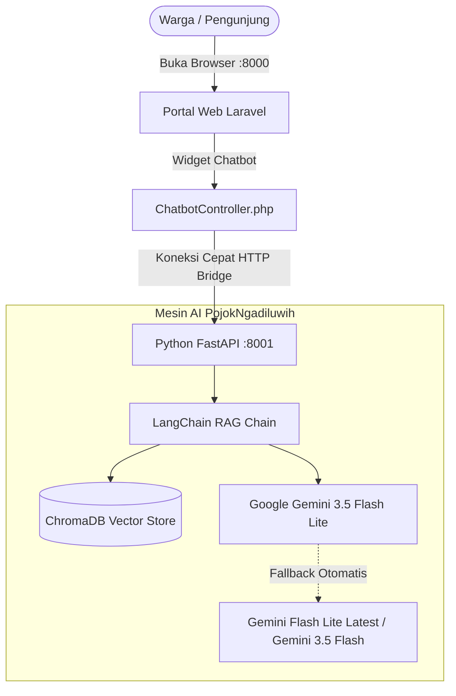

# 📖 Panduan & Rangkuman Proyek PojokNgadiluwih

> **Portal Digital Resmi Desa Ngadiluwih & Asisten AI Cerdas Berbasis RAG (Google Gemini)**  
> Kecamatan Ngadiluwih, Kabupaten Kediri, Jawa Timur

---

## ⚡ Panduan Cepat: Cara Menjalankan & Mematikan Website

Website **PojokNgadiluwih** menggunakan arsitektur modern yang terdiri dari 2 komponen utama:
1. **Web Utama (Laravel)** di Port `8000`
2. **Service Otak AI (Python FastAPI)** di Port `8001`

Keduanya **harus sama-sama menyala** di terminal terpisah agar semua fitur website dan chatbot AI berfungsi normal.

---

### 🟢 1. Cara Menyalakan (Start) Website

Buka **2 tab terminal** (PowerShell / Command Prompt) di VS Code:

#### Tab Terminal 1: Aplikasi Web Laravel
```powershell
cd d:\pojokngadiluwih
php artisan serve
```
> 🌐 Akses website warga di browser: **[http://127.0.0.1:8000](http://127.0.0.1:8000)**

---

#### Tab Terminal 2: Service Otak AI (Python)
```powershell
cd d:\pojokngadiluwih\ai_service
.venv\Scripts\activate
uvicorn app.main:app --host 127.0.0.1 --port 8001 --reload
```
> 🤖 Service AI aktif dan melayani tanya-jawab di: **`http://127.0.0.1:8001`**  
> 📑 Dokumentasi API AI (Swagger UI): **[http://127.0.0.1:8001/docs](http://127.0.0.1:8001/docs)**

---

### 🔴 2. Cara Mematikan (Stop) Website

Untuk mematikan server yang sedang berjalan:

1. Klik pada jendela / tab terminal yang ingin dimatikan (baik tab Laravel maupun tab Python).
2. Tekan tombol kombinasi keyboard:
   ```text
   Ctrl + C
   ```
3. Jika di terminal muncul pertanyaan:
   ```text
   Terminate batch job (Y/N)?
   ```
   Ketik huruf **`Y`** lalu tekan **`Enter`**.
4. Lakukan hal yang sama pada tab terminal satunya. Selesai! Server sudah berhenti sepenuhnya.

---

## 🧠 Ringkasan Arsitektur & Peningkatan AI Terbaru



### 🚀 Peningkatan Utama yang Telah Dilakukan:

1. **Kecepatan Respon Super Kilat (1–2 Detik)**
   - Sebelumnya, model lama membutuhkan waktu 25–40 detik.
   - Sekarang menggunakan model **`gemini-3.5-flash-lite`** yang sangat gesit, menghasilkan jawaban hanya dalam **~1,2 hingga 1,8 detik**.

2. **AI Menggunakan Nalar Alami (Bukan Template Kaku)**
   - Asisten AI telah dibekali prompt bernalar komunikatif layaknya ChatGPT/Gemini web.
   - Pertanyaan santai, sapaan, maupun pertanyaan pertimbangan (contoh: *"enakan langsung ke kantor atau di sini?"*) langsung dijawab secara luwes, rasional, dan ramah.
   - Pertanyaan seputar desa (surat SKU/SKCK/SKTM, nama kepala desa, jadwal balai desa, produk UMKM) dijawab akurat berdasarkan dokumen resmi desa.

3. **Sistem Multi-Model Fallback (Anti Kuota Habis)**
   - Jika satu model Gemini mengalami antrean limit dari Google, sistem secara otomatis mengalihkan request ke model cadangan:
     1. Prioritas 1: `gemini-3.5-flash-lite`
     2. Prioritas 2: `gemini-flash-lite-latest`
     3. Prioritas 3: `gemini-3.5-flash`
   - Pengguna tidak akan terganggu oleh error kuota habis.

4. **Koneksi Stabil & Bebas Timeout**
   - Timeout di Laravel dinaikkan menjadi 120 detik dengan konfigurasi `ini_set('max_execution_time', 150)`.
   - Template pesan cadangan yang monoton dan kaku telah dihilangkan.

---

## 📁 Struktur Komponen Penting Proyek

| Bagian | Path Berkas | Fungsi Utama |
|---|---|---|
| **Chatbot Frontend** | `resources/views/layouts/components/chatbot-widget.blade.php` | Widget melayang, bubble chat, animasi loading, formatting markdown bold/italic |
| **Bridge Controller** | `app/Http/Controllers/Public/ChatbotController.php` | Jembatan pengirim pesan dari Laravel ke Python AI |
| **Konfigurasi Web** | `config/services.php` & `.env` | URL service AI (`http://127.0.0.1:8001/api/chat`) dan timeout |
| **FastAPI App** | `ai_service/app/main.py` | Endpoint REST API `/api/chat`, `/api/health`, dan `/api/reindex` |
| **Otak RAG AI** | `ai_service/app/rag_chain.py` | Prompt nalar cerdas, integrasi LangChain, dan fallback model Gemini |
| **Vector Database** | `ai_service/app/vector_store.py` | ChromaDB + Model embedding teks lokal (`all-MiniLM-L6-v2`) |
| **Arsip Dokumen** | `ai_service/data/knowledge_base/*.txt` | Dokumen resmi desa (profil desa, layanan surat, katalog UMKM warga) |

---

## 🛠️ Tips Troubleshooting Cepat

- **Tanya: Mengapa chatbot hanya menampilkan pesan koneksi terputus?**  
  *Jawab*: Pastikan Terminal 2 (Python FastAPI di port `8001`) sudah menyala dan tidak tertutup.
- **Tanya: Ingin mengubah atau menambah data surat / UMKM baru untuk AI?**  
  *Jawab*: Cukup edit atau tambahkan file teks di `ai_service/data/knowledge_base/`, lalu lakukan request POST ke `http://127.0.0.1:8001/api/reindex` atau restart server Python.
